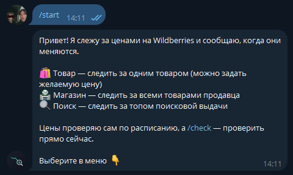
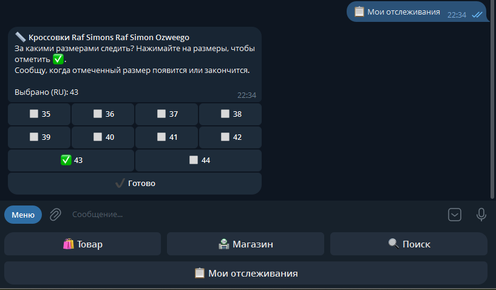
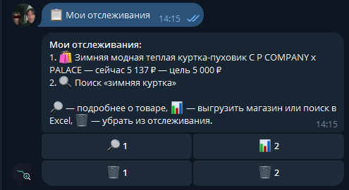
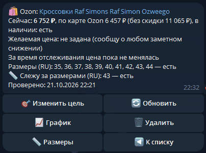
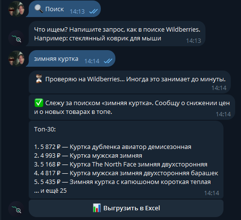
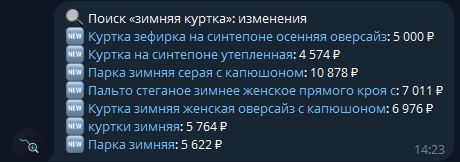
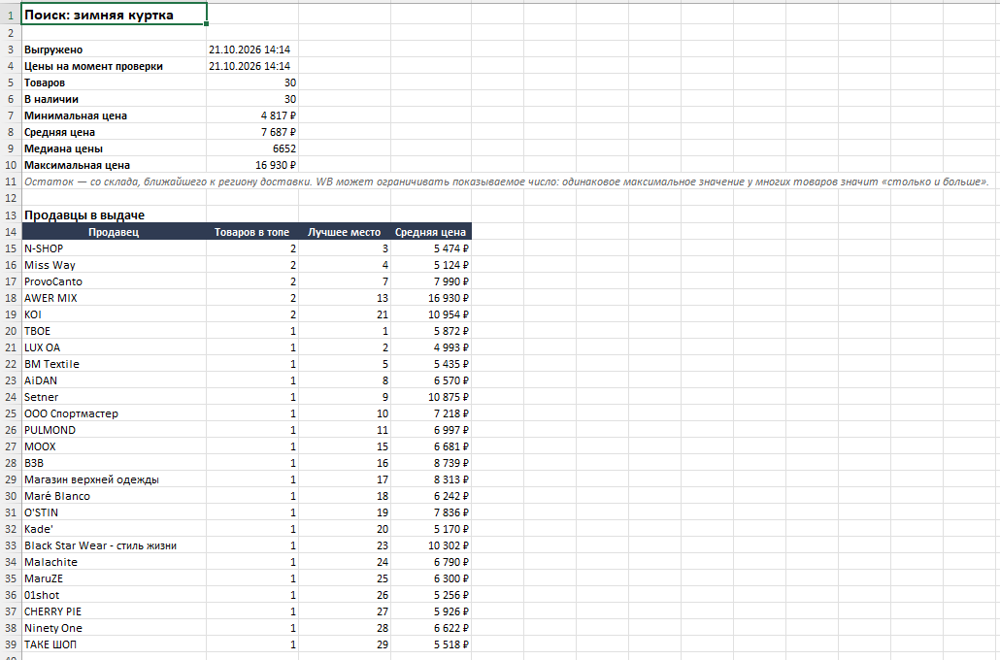
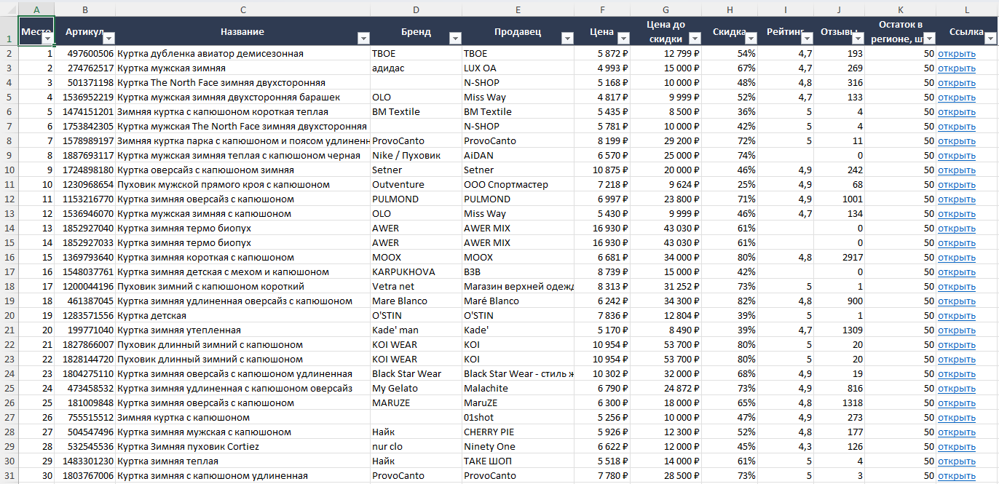

# Price Monitor — Telegram-бот для мониторинга цен на Wildberries и Ozon

[](https://github.com/SHUHER322/price_monitor/actions/workflows/tests.yml)

Бот следит за ценами на Wildberries и Ozon и сам присылает уведомления, когда
что-то меняется. Отслеживать можно отдельный товар (WB или Ozon), все товары
конкурента или топ поисковой выдачи (WB). Магазин и выдачу можно выгрузить в Excel с аналитикой.

**Стек:** Python 3.14, aiogram 3, httpx, Patchright (Chrome), SQLite (aiosqlite),
APScheduler, openpyxl, matplotlib, pytest + GitHub Actions.

## Как это выглядит

<table>
  <tr>
    <th>Меню</th>
    <th>Товар с размерами</th>
    <th>Мои отслеживания</th>
    <th>Карточка товара</th>
    <th>Топ поиска</th>
  </tr>
  <tr>
    <td></td>
    <td></td>
    <td></td>
    <td></td>
    <td></td>
  </tr>
</table>

Уведомление: в топе поиска закрепились новые товары (бот сам проверяет по расписанию):



Выгрузка поиска «зимняя куртка» в Excel — сводка с продавцами в выдаче и все товары:





## Возможности

**Что отслеживать** — выбирается кнопками в меню:

- 🛍 **Товар** — по ссылке на Wildberries или Ozon. Можно задать желаемую цену.
  Для одежды на WB видны цены и остатки по каждому размеру, на Ozon — ещё и цена
  по карте Ozon.
- 🏪 **Магазин** — все товары продавца WB по ссылке на его страницу.
- 🔍 **Поиск** — топ-N выдачи WB по запросу (по умолчанию 30), как его видит покупатель.

**Уведомления** — бот проверяет всё по расписанию (по умолчанию раз в 6 часов):

- 📉 цена снизилась больше чем на заданный процент
- 🎯 цена опустилась до желаемой (один раз — в момент, когда пересекла цель)
- ❌ товар закончился / ✅ снова в наличии
- 🆕 новый товар у продавца или в топе выдачи (для поиска — только если товар
  продержался в топе две проверки подряд: WB перемешивает выдачу, и без этого
  были бы ложные «новинки»)

Изменения по магазину и поиску приходят одним сообщением, а не десятками.

**Карточка товара** — цена, желаемая цена, минимум и максимум за время
отслеживания, размеры в наличии. Кнопки: изменить цель, обновить с WB,
📈 график истории цены, удалить. Всё меняется в одном сообщении, без спама в чат.

**Выгрузка в Excel** (магазин и поиск):

- лист «Сводка»: число товаров, минимальная / средняя / медианная / максимальная цена;
  для поиска — таблица «Продавцы в выдаче» (сколько товаров в топе, лучшее место,
  средняя цена)
- лист «Товары»: место в выдаче, артикул, название, бренд, продавец, цена,
  цена до скидки, скидка, рейтинг, отзывы, остаток, ссылка; с фильтрами

## Как устроен парсинг

С октября 2026 года открытые JSON-адреса Wildberries (`card.wb.ru`, `search.wb.ru`)
отвечают 403, и многие парсеры на GitHub перестали работать. Этот проект
использует внутренние адреса сайта `/__internal/…`, которые требуют антибот-токен:

1. Настоящий Chrome (через Patchright — Playwright без следов автоматизации)
   открывает страницу WB и получает токен `x_wbaas_token` и заголовки браузера.
2. Токен сохраняется в файл, дальше данные берутся быстрыми запросами `httpx` —
   браузер нужен редко.
3. Если WB отверг токен (401/403/498), бот один раз получает новый и повторяет запрос.

**Ozon** защищён строже: он проверяет не только cookie, но и «почерк» соединения
(TLS-отпечаток), поэтому и обычные HTTP-клиенты, и подделка отпечатка Chrome
получают 403. Данные берутся из API страницы `/api/entrypoint-api.bx/…` запросом
изнутри настоящего Chrome: на одну проверку браузер открывается один раз,
и в нём по очереди, с паузами, запрашиваются все товары Ozon.

Бережно к сайтам: товары WB запрашиваются пачками по 100, один магазин или запрос —
один раз, даже если за ним следят несколько пользователей; между страницами —
случайные паузы.

Каждый маркетплейс — отдельный модуль в `app/sources/` с общим форматом данных.
Если WB что-то поменяет, правится один файл, а разведчики в `scripts/` за минуту
покажут новые адреса.

## Запуск

Нужны Python 3.14 и установленный Google Chrome.

```bash
py -V:3.14 -m venv .venv          # Linux/macOS: python3 -m venv .venv
.venv\Scripts\activate            # Linux/macOS: source .venv/bin/activate
pip install -r requirements.txt
copy .env.example .env            # Linux/macOS: cp .env.example .env
# вписать в .env BOT_TOKEN (от @BotFather) и свой Telegram ID в ALLOWED_USERS
python -m app.main
```

На Windows можно запускать **двойным кликом по `run.bat`** или **F5 в VS Code**.

При первом запросе к WB откроется окно Chrome — бот получает антибот-токен.
Окно закроется само примерно через полминуты, ничего в нём нажимать не нужно.

## Настройки (`.env`)

| Параметр | По умолчанию | Что задаёт |
|---|---|---|
| `BOT_TOKEN` | — | токен бота от @BotFather |
| `ALLOWED_USERS` | — | кто может пользоваться ботом: Telegram ID через запятую |
| `CHECK_INTERVAL_HOURS` | 6 | как часто проверять цены |
| `PRICE_DROP_PERCENT` | 5 | порог снижения цены для уведомления, % |
| `SEARCH_LIMIT` | 30 | сколько товаров брать из поиска |
| `SELLER_LIMIT` | 500 | сколько товаров магазина отслеживать |
| `MAX_TRACKINGS` | 20 | лимит отслеживаний на одного пользователя |
| `WB_DEST` | 1259570991 | регион доставки WB (от него зависят цены и наличие) |
| `TIMEZONE` | Asia/Tomsk | часовой пояс для времени в сообщениях и Excel |

Бот приватный: тем, кого нет в `ALLOWED_USERS`, он отвечает «Это приватный бот»
и показывает их ID — его можно добавить в список.

## Команды

- `/start` — меню
- `/list` — мои отслеживания
- `/check` — проверить цены прямо сейчас
- `/cancel` — отменить текущее действие

## Структура

```
app/
  sources/
    base.py     — общий формат товара (ProductInfo) и ошибки источников
    wb.py       — Wildberries: токен, товар, пачки, поиск, магазин
    ozon.py     — Ozon: запросы к API страницы через Chrome
  config.py     — настройки из .env с проверкой значений
  db.py         — SQLite: отслеживания, история цен, миграции
  checker.py    — проверка по расписанию и уведомления
  handlers.py   — диалоги с пользователем
  keyboards.py  — кнопки
  formatting.py — тексты сообщений, разбор суммы
  excel.py      — выгрузка в Excel
  chart.py      — график истории цены
  access.py     — доступ только для ALLOWED_USERS
  main.py       — запуск бота и расписания
scripts/        — разведчики: как WB отдаёт данные (для починки при изменениях сайта)
tests/          — pytest; ответы WB — сохранённые файлы в tests/fixtures/
```

## Тесты

```bash
pytest -q
```

Тесты не ходят в интернет: ответы WB подменяются сохранёнными файлами
и `httpx.MockTransport`, база — временный файл. Поэтому они не ломаются,
когда WB меняет защиту. На GitHub тесты запускаются автоматически при каждом push.

## Ограничения

- Ozon пока поддерживается только для отдельных товаров; магазины и поиск — только WB.
- Ozon не показывает количество на складе — только «есть / нет». Размеры на Ozon —
  отдельные товары со своими ссылками.
- Проверка товаров Ozon открывает окно Chrome на несколько секунд; на сервере для этого
  нужен виртуальный экран.
- Остаток WB показывает со склада, ближайшего к региону доставки, и может
  ограничивать показываемое число: одинаковое максимальное значение у многих
  товаров означает «столько и больше».
- Пользовательские соглашения Wildberries и Ozon ограничивают автоматический сбор данных.
  Проект учебный: используйте его ответственно, с умеренной частотой запросов.
